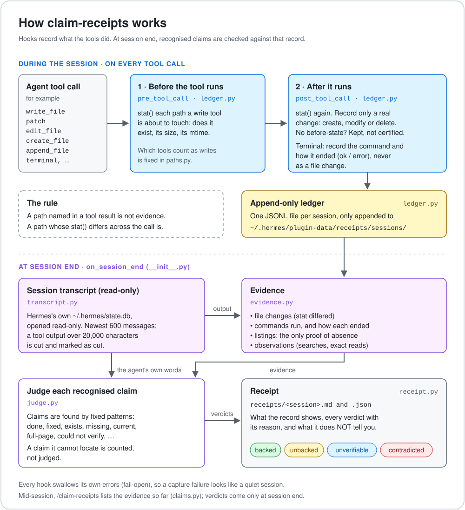
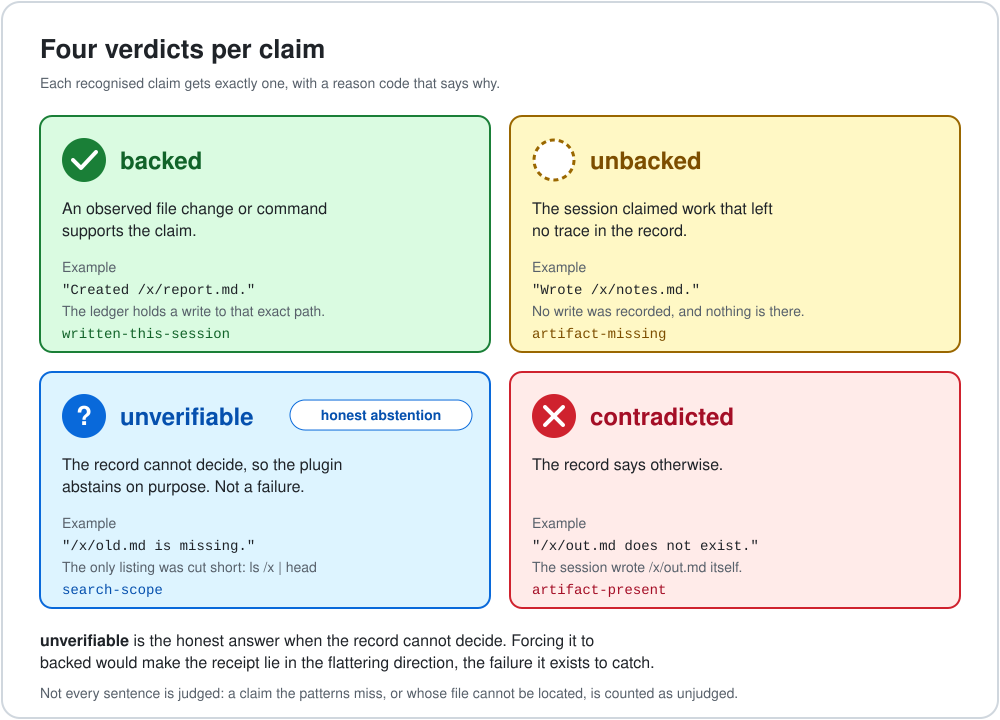
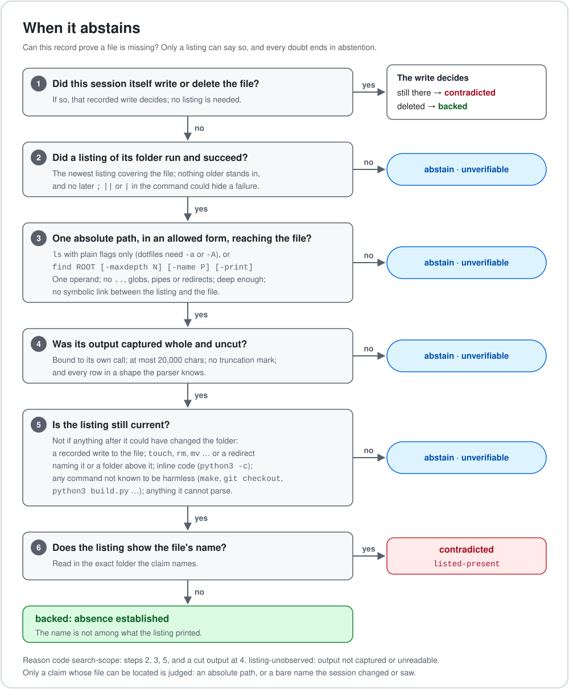

# Understanding claim-receipts
### The same idea told four ways: from age 5 to master

> **The 30-second version.** An AI agent says "done". claim-receipts checks that sentence against what the
> agent's tools actually did in the session, and gives it one of four verdicts: **backed**, **unbacked**,
> **unverifiable** or **contradicted**. When the record cannot settle a claim, it says so instead of guessing.
> It compares a claim with a capture; it never proves a claim true.

**Status:** written 2026-11-11 for the first public release. Every statement here can be checked against the code
and against [`KNOWN_LIMITS.md`](../KNOWN_LIMITS.md). When this file and `KNOWN_LIMITS.md` disagree,
`KNOWN_LIMITS.md` wins.

---

## How to read this

Each idea is told four times. Read only as deep as you want.

| Level | For | It answers |
|---|---|---|
| 🧒 **Age 5** | anyone | What is it like? |
| 📖 **Student** | someone who uses AI agents | What does it do, exactly? |
| 🎓 **PhD** | someone who will read the code | How does it decide? |
| 🔬 **Master** | someone who will try to break it | Where are the edges, and how do we know? |

**Jargon decoder.** *Claim:* a sentence where the agent says it did or found something. *Capture:* the record of
what the agent's tools did. *Verdict:* the plugin's answer about one claim. *Abstain:* answer "can't tell from
here" (`unverifiable`). *Hook:* a function Hermes calls before and after every tool the agent uses.
Every word has its own page in [`definitions/`](definitions/README.md); the reason codes you will see in a receipt
are in [`definitions/WORD_KEY.md`](definitions/WORD_KEY.md).

**Where to start.** Using it: read Ideas 1 and 2, then install from the [README](../README.md). Trusting a
verdict: read Idea 4 and `KNOWN_LIMITS.md`. Breaking it: read Idea 5, then open an issue with the receipt.

---

## Idea 1: A claim is not a capture

### 🧒 Age 5
Your friend says "I cleaned my room." You peek in the room. Now you know whether the room looks cleaned.
claim-receipts is the peek.

### 📖 Student
While the agent works, the plugin watches its tools. When a tool writes a file, it checks the file before and
after. When the agent runs a terminal command, it writes down the command and whether it worked. At the end of
the session it reads the agent's own words, finds the sentences that claim something ("I created report.md",
"the tests pass", "the file is missing"), and checks each one against that record.

### 🎓 PhD
Three layers. `receipts/ledger.py` is called by Hermes's `pre_tool_call` and `post_tool_call` hooks: it
`stat()`s the paths a write is about to touch, stats them again afterwards, and appends a record only when the
stat changed, plus the command string and status for terminal calls, to an append-only JSONL ledger under
the plugin's data folder. At `on_session_end`, `receipts/transcript.py` reads the session's own messages from
Hermes's `state.db` (read-only, current session only) so each command's output can be bound to the call that
produced it. `receipts/evidence.py` turns ledger and transcript into evidence; `receipts/judge.py` finds the
claims it recognises and judges each; `receipts/receipt.py` writes the receipt.

### 🔬 Master
The rule the whole design rests on: **a path named in a tool result is not evidence; a path whose `stat()`
differs across the call is.** Everything else follows from refusing to treat text as action. A command that
merely *prints* a path did not touch it; a listing that ran but was cut off did not see everything; a
measurement whose producer failed measured nothing. The capture is bounded by what the hooks could see: a change
made outside an observed tool call is invisible, and absence of evidence here is never evidence of absence.

---

## Idea 2: Four verdicts, and why there are four

### 🧒 Age 5
There are four answers. "Yes, I saw it." "I looked and it isn't there." "I can't tell from here." "No, I saw the
opposite."

### 📖 Student
| Verdict | Means |
|---|---|
| **backed** | the record supports it: a recorded write to the file, or a successful observation, listing or measurement of it |
| **unbacked** | the session claimed work that left no trace in the capture |
| **unverifiable** | the record cannot settle this claim, so the plugin abstains |
| **contradicted** | the record directly conflicts with the claim |

### 🎓 PhD
`unverifiable` and `contradicted` are not the same as `unbacked`. *Unbacked* means "no trace found";
*contradicted* means "the trace says otherwise" (for example, the file exists and the session says it is
missing); *unverifiable* means "this record cannot decide" (a listing that went stale, a measurement whose producer
failed, a repair that cannot be bound to the failing check). A claim whose file cannot be located at all is not
judged; it is counted as unjudged in the receipt. Opinions and plans are mostly never picked up
as claims at all. Each verdict carries a reason code, such as `written-this-session`,
`later-error` or `search-scope`, so a reader can see why. The codes are listed in
[`definitions/WORD_KEY.md`](definitions/WORD_KEY.md).

### 🔬 Master
Forcing every claim into backed or not-backed would make the record lie in the flattering direction, which is
the failure the plugin exists to catch. So the design treats `unverifiable` as a first-class answer, and the
worst error is a false **contradicted**, an honest agent accused. Across the repair rounds that error was
measured at zero on the 50 realistic true-claim cases of the last independent pass, and every false
contradiction an auditor or attacker found along the way is now a test (see Idea 5).

---

## Idea 3: What counts as seeing

### 🧒 Age 5
Saying "I looked under the bed" is not the same as looking under the bed. The plugin only counts the looking.

### 📖 Student
An observation counts only when the command really ran, really succeeded, and really covered the thing the claim
is about. `ls -la /x/folder` that worked can show a file is missing from that folder. `echo "ls /x/folder"`
prints words and observes nothing. A listing, followed by a command that might have changed the folder, no
longer speaks for the folder.

### 🎓 PhD
`receipts/evidence.py` admits a listing only in a small allowed form (one absolute folder; a fixed set of `ls`
flags, or `find ROOT [-maxdepth N] [-name P] [-print]`), only from a command it can split on unquoted
separators, and only when no later `;`, `||` or `|` could hide the listing's failure. Hidden files need `-a`.
Output cut by the reader cannot prove absence. A later command that is neither known to only look nor known to
change only the files it names makes every earlier listing stale. Hedges ("I could not confirm X") need a
successful read or listing of exactly X (a hedge naming a relative path cannot be backed); a hedge that names no
file is backed only by an observe tool such as
`web_search`.

### 🔬 Master
These are **fail-closed** rules: each admits a shape it can support and refuses everything else, rather than
trying to recognise every harmful spelling. The cost is deliberate: many honest sessions use shapes the plugin
does not read (`2>/dev/null`, `| head`, `cd X && ls`), and those claims abstain. On 50 realistic synthetic
cases where the claim was true, 32 (64%) were backed, the rest abstained, and none was contradicted. That is a
set of exposed test cases, not an accuracy estimate.

---

## Idea 4: Abstaining is the honest failure

### 🧒 Age 5
If you can't see into the room, the right answer is "I don't know", not "yes".

### 📖 Student
When the plugin is not sure, it says `unverifiable`. That is a feature. A tool that always answers would
sometimes answer wrong, and a wrong "yes" is how agents get away with work they did not do.

### 🎓 PhD
Every repair in this release was made by **narrowing**: removing a favourable verdict the evidence could not
support and letting the claim abstain, never by changing an expected result to make a test pass. Each narrowing
is named in `KNOWN_LIMITS.md`. Examples: a failed check followed by a *different* successful command no longer
counts as a repair; a re-run counts only if it is the complete, identical command in the same recorded folder
(Hermes does not record the folder, so on a live session only a write to the exact file clears a failure); any
git command except a plain `git status` after a listing makes the listing stale.

### 🔬 Master
Abstention has a price, and it is reported rather than hidden: the share of true claims that get backed.
Reading more shapes would raise it, and each new shape is a new way to be wrong. The release takes the side of
being right when it speaks.

---

## Idea 5: How we know it does what it says

### 🧒 Age 5
We asked other people to try to trick it, fixed every trick they found, and then asked again.

### 📖 Student
An independent auditor (Codex) reviewed the plugin's source and history and listed what was wrong. The fixes
were then attacked by two more independent passes on different models, whose cases were fixed too. Codex
rechecked three more times and each time found close neighbours of the same problems; those were fixed by
narrowing each rule to a shape it can support. Every case any of them found is now a test that runs every time. Codex's
verdict on the released commit is linked from the catalog entry.

### 🎓 PhD
`make test` runs the unit tests and every auditor's adopted probe; `make acceptance` scores 35 exposed fixture
cases and exits non-zero unless the original eight meet 7 of 8 with both positives and **every** added
regression case comes out as expected. Each new test was shown to fail on the commit before its fix (a test that
cannot fail proves nothing), and the acceptance gate was shown to reject deliberately broken copies of the judge.

### 🔬 Master
None of this is held-out validation, and the plugin has not been run inside a live Hermes session by its
authors; its hooks were tested against synthetic sessions built the way Hermes stores them. The honest summary is
in [`KNOWN_LIMITS.md`](../KNOWN_LIMITS.md), and the best way to improve it is to break it:

> Found a verdict you think is wrong? Open an issue with the receipt attached. We especially want the cases where
> it says **backed** and should not. Wrong verdicts become tests.
